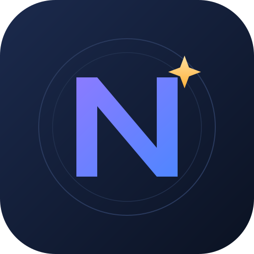

  

  <h1>Netigo</h1>

  
<strong>Hedefin net, yolun Netigo.</strong>

  
LGS'ye hazırlanan 8. sınıf öğrencileri için yapay zekâ destekli çalışma koçu.

  

    
    
    
  

  

    
  

---

Netigo; çözdüğün soruları kaydeder, netlerini takip eder, hedefine göre haftalık ders programı hazırlar ve takıldığın sorularda yanında olur. **Netigo AI** uygulamanın içinde hazır gelir; ek hesap, API anahtarı veya ayar istemez.

## 📥 İndir

Son sürüm: **[v1.0.0](../../releases/latest)**

| Dosya | Kimler için | Boyut |
|---|---|---|
| **[app-arm64-v8a-release.apk](../../releases/latest/download/app-arm64-v8a-release.apk)** | **Önerilen** — 2018 ve sonrası çoğu telefon (64-bit) | 21 MB |
| [app-armeabi-v7a-release.apk](../../releases/latest/download/app-armeabi-v7a-release.apk) | Eski / 32-bit telefonlar | 19 MB |
| [app-release.apk](../../releases/latest/download/app-release.apk) | Her cihaz (işlemci ayrımı yapmaz) | 61 MB |
| [app-x86_64-release.apk](../../releases/latest/download/app-x86_64-release.apk) | Emülatör | 23 MB |

> İndirdiğin dosyanın doğruluğunu release içindeki **SHA256.txt** ile kontrol edebilirsin.

## 🚀 Kurulum

1. Telefonuna uygun APK'yı indir.
2. **Dosyalar** uygulamasından APK'ya dokun.
3. "Bilinmeyen kaynaklara izin ver" uyarısı çıkarsa izin ver.
4. **Kur → Aç.**

Android 7.0 ve üzeri sürümler desteklenir.

## ✨ Özellikler

- **📊 Günlük soru takibi:** Ders, konu, yayın evi ve doğru / yanlış / boş kaydı. Net otomatik hesaplanır.
- **🧠 Netigo AI koç:** Son 7 günün verilerini, çalışma serini ve programını analiz eder; sana özel tavsiye verir.
- **📸 Fotoğraftan soru çözümü:** Sorunun fotoğrafını çek veya galeriden seç; adım adım çözüm al.
- **🗓️ Haftalık program + PDF:** Hedefine, günlük sürene, zayıf derslerine ve deneme netlerine göre 7 günlük program. A4 PDF olarak kaydet, görüntüle, paylaş.
- **📈 İstatistikler:** Son 7 gün grafiği, ders bazlı netler, çalışma serisi.
- **🔒 Cihazda ve gizli:** Hesap ve çalışma kayıtları telefonunda; reklam ve takip yok.
- **🌙 Karanlık tema.**

## 🧠 Netigo AI

Netigo AI, her görev için en uygun modeli otomatik seçer. Kullanıcıdan hiçbir ayar istemez.

| Görev | Netigo AI ne yapar? |
|---|---|
| Koç sohbeti | Son 7 günün verilerini okuyup kişisel tavsiye verir |
| Fotoğraflı soru çözümü | Görsel destekli modelle soruyu adım adım çözer |
| Haftalık program | Hedefine göre 7 günlük plan üretir |
| Yedekleme | Bir model yanıt veremezse otomatik olarak yedek modele geçer |

> Ek ücret, hesap veya API anahtarı gerekmez. Yoğun kullanımda kısa süreli yanıt gecikmesi olabilir.

## 🎯 Neden Netigo?

- **Verilerine dayanır:** Tavsiyeler tahmin değil, çözdüğün soruların analizidir.
- **Yol gösterir:** Her hafta net bir program, her gün net bir hedef.
- **Takıldığında yanındadır:** Çözemediğin sorunun fotoğrafını çek, adım adım anlatsın.
- **Tamamen cebinde:** İnternet olmadan da kayıtlarını tut, istediğin an çalış.

## 🔐 Gizlilik

- Hesap bilgileri, profil fotoğrafı, soru kayıtları ve PDF'ler **cihazında** saklanır.
- Yapay zekâ özelliklerini kullandığında **mesajın, soru fotoğrafın, kullanıcı adın, son 7 günün özet verileri ve program tercihlerin** Netigo AI hizmetine iletilir.
- Reklam yok, analitik yok, üçüncü taraf takip yok.
- Uygulamayı silersen cihazdaki kayıtlar da silinir.

## ❓ Sık sorulanlar

**Hangi dosyayı indireyim?**  
Çoğu telefon için `app-arm64-v8a-release.apk`. Emin değilsen `app-release.apk` her cihazda çalışır.

**AI için ayrıca ödeme veya anahtar gerekiyor mu?**  
Hayır. Netigo AI uygulamanın içinde hazır gelir.

**Verilerim nereye kaydediliyor?**  
Cihazına. Hesap bilgilerin ve çalışma kayıtların bir sunucuya gönderilmez. AI kullanırken mesajın, fotoğrafın ve özet verilerin Netigo AI hizmetine iletilir.

**PDF'ler nerede?**  
Uygulamanın özel klasöründe. Program ekranından görüntüleyebilir veya paylaşabilirsin.

**Eski Pusula kayıtlarım taşınır mı?**  
Hayır. Netigo ayrı bir uygulama olarak kurulur; eski kayıtlar taşınmaz. İki uygulama aynı anda kullanılabilir.

## 🆕 Sürüm notları — v1.0.0

- İlk sürüm.
- Günlük soru takibi, Netigo AI koç, fotoğraftan soru çözümü ve haftalık PDF program.
- Göreve göre otomatik model seçimi ve yedek model desteği.
- Karanlık tema ve sade arayüz.

## 📬 İletişim

**Mars Studios CO.**  
📧 [m.sevki404@gmail.com](mailto:m.sevki404@gmail.com)  
📞 +90 554 185 70 60

Görüş, öneri ve hata bildirimleri için yazabilirsin.

---

  © 2026 Mars Studios CO. · Netigo

